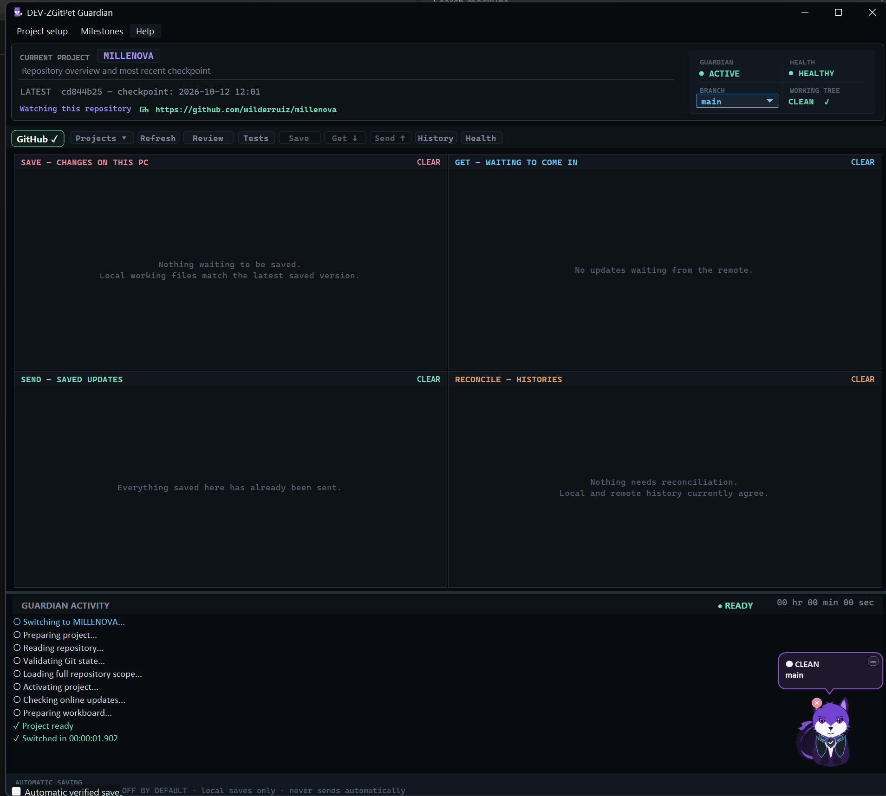
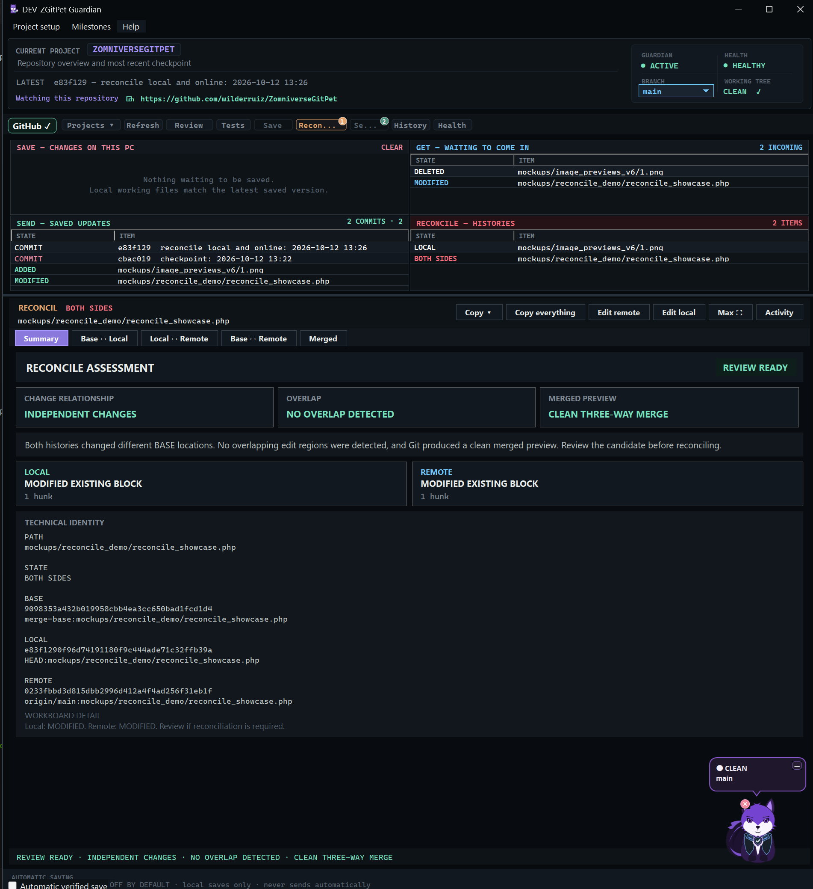
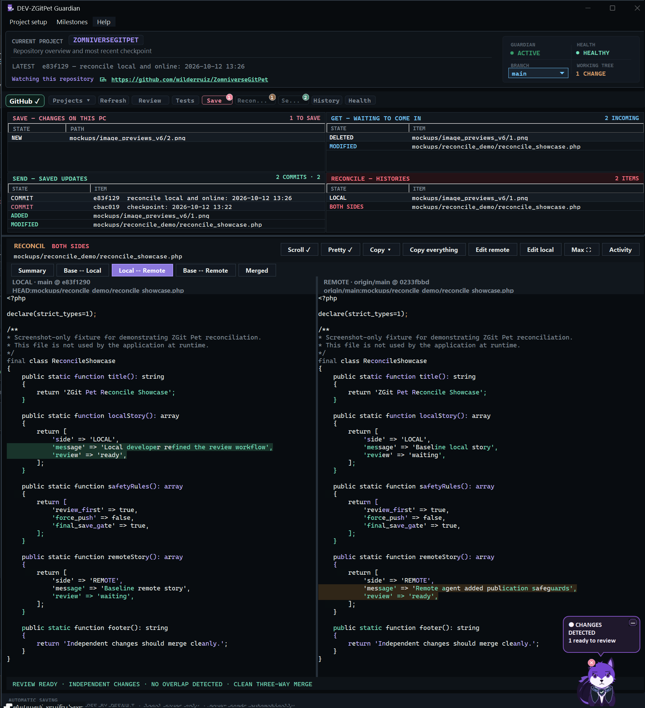
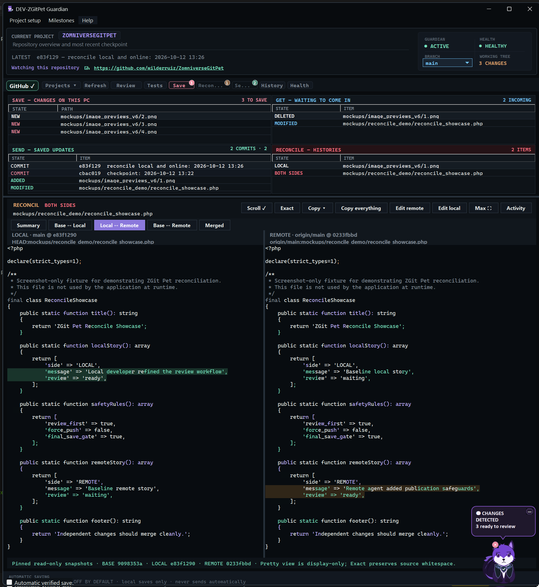
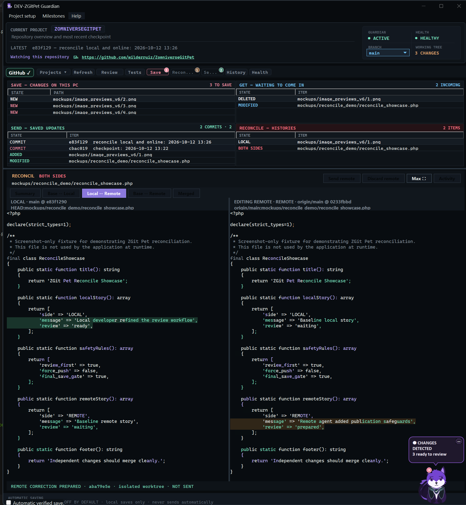
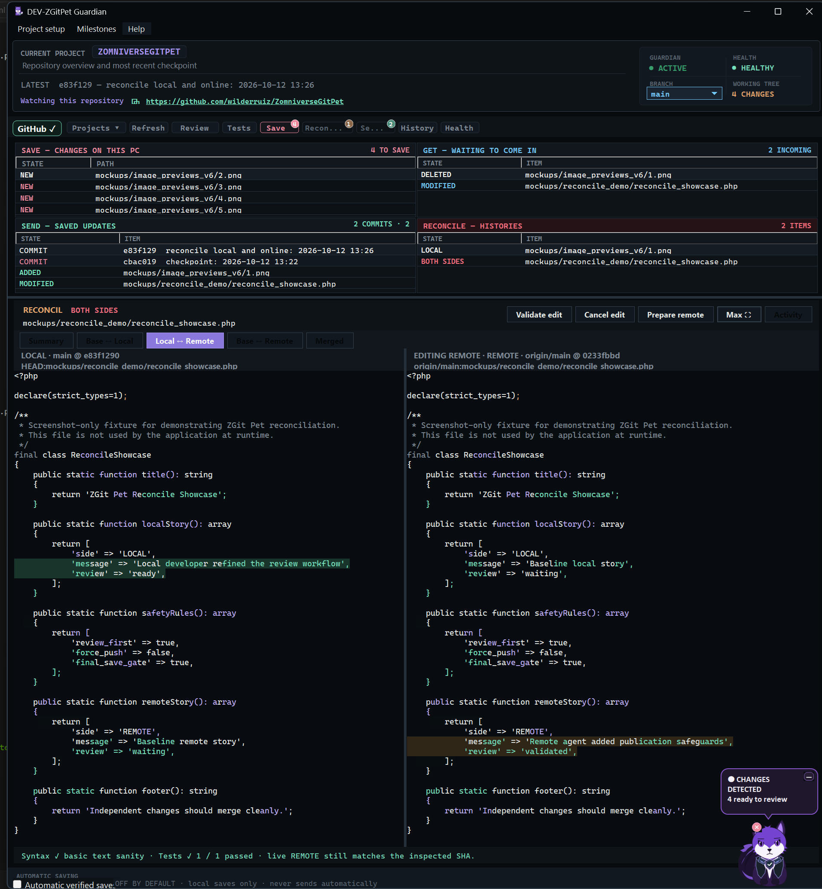
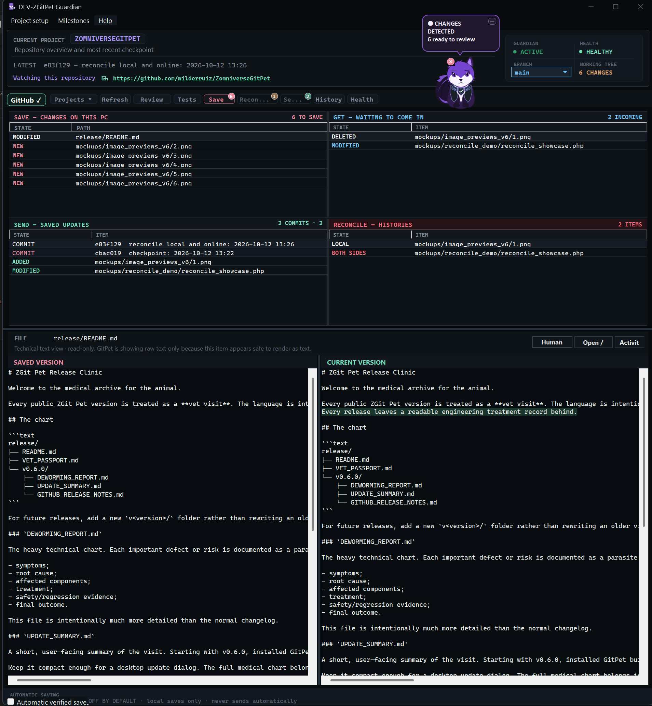
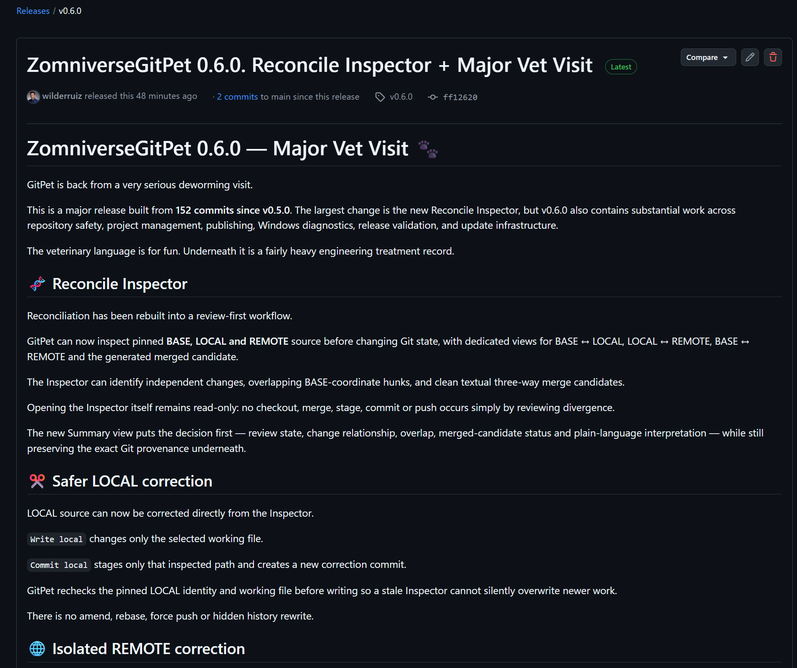

<p align="center">
  
</p>

<h1 align="center">ZomniverseGitPet</h1>

<p align="center"><strong>A desktop Git guardian for human + AI-assisted development.</strong></p>

<p align="center">
  <strong>Windows 10 / 11 x64</strong>
  &nbsp;•&nbsp;
  <strong>Native .NET 8 WinForms</strong>
  &nbsp;•&nbsp;
  <strong>Direct2D / DirectX Guardian</strong>
  &nbsp;•&nbsp;
  <strong>MIT</strong>
</p>

<p align="center">
  <strong>Review what changed → Save locally → Get remote work → Send saved work → Reconcile safely</strong>
</p>

<p align="center">
  <a href="https://github.com/wilderruiz/ZomniverseGitPet/releases/latest"><strong>Download the latest release</strong></a>
  &nbsp;·&nbsp;
  <a href="docs/user/RECONCILIATION.md">Reconciliation guide</a>
  &nbsp;·&nbsp;
  <a href="release/VET_PASSPORT.md">Vet passport 🐾</a>
</p>

---

## What is ZGit Pet?

ZomniverseGitPet turns everyday Git safety into a visible desktop workflow.

Instead of making you continuously translate `status`, `pull`, `push`, staging, divergence and merge state in your head, GitPet keeps the important repository states on one screen:

<table>
  <tr>
    <td width="25%"><strong>SAVE</strong><br><sub>Unsaved changes on this PC.</sub></td>
    <td width="25%"><strong>GET ↓</strong><br><sub>Remote work waiting to come in.</sub></td>
    <td width="25%"><strong>SEND ↑</strong><br><sub>Already-saved local work waiting to go out.</sub></td>
    <td width="25%"><strong>RECONCILE</strong><br><sub>Local and remote histories disagree and need review.</sub></td>
  </tr>
</table>

It is especially useful when **humans and remote/AI coding agents are touching the same repository**. GitPet makes that collaboration explicit: inspect incoming and local work, validate it, save ordinary Git commits, and send only when you decide the result is ready.

> Current application version: **0.6.0**  
> v0.6.0 is the **Reconcile Inspector + Major Vet Visit** release. It was built from 152 commits since v0.5.0 and passed the complete isolated release regression suite before publication.

---

# v0.6.0 — Reconcile Inspector

The major v0.6 change is a review-first reconciliation workflow built around pinned **BASE / LOCAL / REMOTE** history.

Opening the Inspector does not start a merge. GitPet first shows you what each history contains, how each side changed from the common ancestor, whether edit regions overlap, and whether Git can generate a clean textual three-way candidate.

<p align="center">
  
</p>

The Summary view is deliberately decision-first. A clean independent-change case can show:

- **REVIEW READY**
- **INDEPENDENT CHANGES**
- **NO OVERLAP DETECTED**
- **CLEAN THREE-WAY MERGE**

while the exact BASE / LOCAL / REMOTE identities remain visible underneath.

The Inspector includes five review surfaces:

| View | Purpose |
| --- | --- |
| **Summary** | Human-readable change relationship, overlap and merge-candidate assessment |
| **BASE ↔ LOCAL** | What LOCAL changed from the common ancestor |
| **LOCAL ↔ REMOTE** | The two current histories side by side |
| **BASE ↔ REMOTE** | What REMOTE changed from the common ancestor |
| **Merged** | LOCAL beside GitPet's generated three-way candidate |

<p align="center">
  
</p>

The source panes use the same hardened code renderer as File Review: syntax-aware presentation, BASE-derived changed-line highlighting, linked scrolling, persistent splitter state, per-view scroll memory, Pretty/Exact display modes and maximized review.

**Pretty is presentation only.** Raw source remains authoritative for copy, edits and Git operations.

---

## Edit the merged candidate without losing the evidence

A generated candidate is preserved as immutable evidence on the left. If the final integration needs one more adjustment, **Edit candidate** opens a separate draft on the right.

<p align="center">
  
</p>

The draft can be validated before anything touches repository state. **Accept + reconcile** is a separate explicit action. It starts the normal no-commit reconciliation, writes/stages only the approved selected path, and deliberately leaves `MERGE_HEAD` present so the normal **Save reconciliation** action remains the final local commit gate.

Candidate acceptance never Sends anything.

---

## Correct LOCAL or REMOTE safely

### LOCAL correction

**Edit local** works against the pinned LOCAL snapshot.

- **Validate edit** checks the draft and stale-state assumptions.
- **Write local** changes only the selected working file.
- **Commit local** stages only that inspected path and creates a new correction commit.
- If HEAD or the working file moved after the Inspector snapshot, GitPet refuses to overwrite newer work.

There is no amend, rebase, hidden reset or force-push path in this workflow.

### REMOTE correction

REMOTE editing is intentionally isolated from the primary worktree.

<p align="center">
  
</p>

**Prepare remote** creates a temporary worktree and temporary local branch based on the exact inspected REMOTE commit. The primary working tree and HEAD stay untouched.

The prepared state is explicit:

> **REMOTE CORRECTION PREPARED · isolated worktree · NOT SENT**

**Send remote** is a different action. Immediately before sending, GitPet re-reads the live remote branch tip. If another writer moved REMOTE after preparation, Send is blocked. The push is a normal non-force fast-forward operation.

The regression suite includes the moved-REMOTE race explicitly.

---

## Validation before mutation

LOCAL, REMOTE and merged-candidate drafts can be validated in disposable Git worktrees before mutation.

<p align="center">
  
</p>

Depending on the file type and local tools, validation can include:

- NUL/binary-like source rejection;
- unresolved Git conflict-marker detection;
- JSON parsing;
- XML/SVG/XAML/csproj-family parsing;
- CSS-family structural checks;
- `php -l`;
- `node --check`;
- `python -m py_compile`;
- PowerShell parser validation;
- the project's saved **Test Commands**.

Deterministic syntax/structure failures block mutation. A project-test failure is treated as evidence rather than an infallible oracle: GitPet shows the failure and requires an explicit decision before continuing.

Validation can be stopped without losing the draft, and disposable worktrees are cleaned afterwards.

---

# Ordinary File Review is still the everyday workflow

Reconciliation is the dramatic case. Most GitPet work is simpler: select a changed file and compare the latest saved version with what is on disk now.

<p align="center">
  
</p>

File Review provides:

- **SAVED VERSION** versus **CURRENT VERSION**;
- a human summary view;
- a Technical source view with highlighted changes;
- syntax-aware rendering;
- explicit treatment of new/deleted files;
- protection against accidentally rendering binary or extremely large files as ordinary text.

Untracked folders expand to individual files so a new source file can be reviewed directly rather than appearing as one opaque directory.

See [Save, Get, Send](docs/user/SAVE_GET_SEND.md).

---

# Guardian Command Center

The main Guardian window is organized around repository state instead of low-level Git vocabulary.

| Quadrant | Meaning |
| --- | --- |
| **SAVE — CHANGES ON THIS PC** | Working-tree changes not yet saved as a local checkpoint |
| **GET — WAITING TO COME IN** | Remote work not yet present locally |
| **SEND — SAVED UPDATES** | Local commits/updates not yet sent |
| **RECONCILE — HISTORIES** | Histories disagree and need explicit review |

Above the workboard, GitPet keeps the current project, repository, branch, health, working-tree state and latest checkpoint visible.

The toolbar uses human-first actions:

**GitHub ✓ · Projects · Refresh · Review · Tests · Save · Get ↓ · Send ↑ · History · Health**

The lower **Guardian Activity** area streams the foreground operation, while the small live Guardian communicates state visually.

---

# Save, Get, Send, Reconcile

## Save

**Save is local.** GitPet previews what will be included and creates an ordinary Git commit/checkpoint. Saving never sends automatically.

## Get ↓

For an ordinary tracked branch, Get requires a clean working tree and uses fast-forward-only safety:

```bash
git pull --ff-only origin <current-branch>
```

If histories diverge, Get stops instead of creating a hidden merge.

Scoped logical projects with their own standalone remote use an isolated publishing workspace and validate project boundaries before copying incoming project files into the source workspace.

## Send ↑

Send works with **already-saved** updates. Unsaved work sitting on top is not silently included.

Ordinary repository Send is a normal:

```bash
git push origin <current-branch>
```

GitPet does not force-push `main` as part of normal Send or reconciliation.

## Reconcile

When histories diverge, GitPet moves the situation into **RECONCILE — HISTORIES** and makes the differences inspectable before mutation.

The normal reconciliation command remains explicit:

```bash
git merge --no-commit --no-ff origin/<branch>
```

GitPet waits for the normal **Save** gate before the reconciliation commit is created, and nothing is sent until a separate Send action.

See [Reconciliation](docs/user/RECONCILIATION.md) and [Reconciliation Safety](docs/safety/RECONCILIATION_SAFETY.md).

---

# The live Direct2D Guardian

The desktop companion is a native **Direct2D** renderer, not just a static icon set.

The production Guardian reacts to repository operations with breathing, blinking, tail movement, palette/armor transitions, traffic effects, warnings, failure behavior and resting animation. The renderer is DPI-aware and retains embedded PNG/GDI+ states as a fallback if Direct2D cannot initialize or render.

| Guardian state | What it communicates |
| --- | --- |
| **Idle / Clean** | Repository is quiet and healthy |
| **Thinking / Preparing** | Inspection or preflight is running |
| **Sorting / Packing** | Work is being prepared for a local checkpoint |
| **Incoming** | Remote work is moving toward the repository |
| **Outgoing** | Saved work is being sent |
| **Reconciling** | Two histories are being brought together |
| **Success / Warning / Failure** | Foreground operation result |
| **Resting** | Quiet repository with slower relaxed animation |

Key production sources:

| Source | Responsibility |
| --- | --- |
| `src/ZomniverseGitPet/PetForm.cs` | Desktop host, state priority, bubble/tray interaction and fallback orchestration |
| `src/ZomniverseGitPet/PetDirect2DControl.cs` | Native Direct2D path geometry, animation and activity FX |
| `src/ZomniverseGitPet/PetGuardianModel.cs` | Guardian palettes and shared state/activity model |
| `experiments/LynxLab/` | Isolated renderer-development and A/B validation harness |

---

# Logical projects, scopes and remote agents

One Git repository can contain several remembered GitPet projects without pretending those projects are separate Git roots.

GitPet can:

- remember logical project scope;
- enforce reviewable allow lists;
- compare scope with what Send would actually publish;
- let sibling logical projects safely share one repository root;
- use standalone project remotes/branches through isolated publishing workspaces;
- validate incoming standalone paths before copying them into the source workspace;
- block unsafe project switching while unresolved Save/Get/Send/Reconcile work exists.

This is particularly useful when remote agents work on a scoped part of a larger repository and GitPet remains the local review/save/reconcile boundary.

See [Logical Projects](docs/user/LOGICAL_PROJECTS.md), [Allow Lists](docs/user/ALLOW_LISTS.md), [Project Boundaries](docs/safety/PROJECT_BOUNDARIES.md), and [Publishing Architecture](docs/developer/PUBLISHING_ARCHITECTURE.md).

---

# Projects, GitHub and repository setup

GitPet can open an existing Git repository or safely prepare an ordinary folder after you review what belongs to the project.

For a new local repository, GitPet uses ordinary Git:

```bash
git init -b main
```

Preparation does **not** automatically stage, Save, Get or Send.

GitHub-specific workflows can use the authenticated GitHub CLI. GitPet does not store a personal-access token itself.

Current setup capabilities include:

- first-class GitHub repository creation;
- owner/privacy selection;
- optional initial README;
- connect-to-existing-origin flows;
- nested-repository protection;
- selective project scope;
- `.gitignore` hygiene helpers;
- environment-secret presets with template exceptions;
- exact-path Git `safe.directory` recovery;
- Windows long-path and file-lock-owner diagnostics;
- safer cross-drive repository relocation.

---

# Tests

Each remembered project can keep its own test commands.

Manual test runs execute saved commands in order and stream PASS/FAIL output into **Guardian Activity**. Reconcile validation can reuse the same project tests inside its disposable validation workspace.

Examples can include:

- `npm test`
- `dotnet test`
- `python -m pytest`
- `composer test`
- `cargo test`

when the corresponding project supports them.

---

# Releases, self-update and the Vet Passport 🐾

GitPet now dogfoods its own release process.

<p align="center">
  
</p>

For maintainers, **Milestones → Prepare ZomniverseGitPet application release…** runs the real release pipeline:

1. require a clean exact source tree;
2. build the production app and regression harness;
3. run the complete regression suite from isolated release artifacts;
4. publish a self-contained Windows x64 executable;
5. compile the Windows installer;
6. generate `release-manifest.json`;
7. generate SHA-256 checksums;
8. keep publication as a separate explicit confirmation.

The publisher verifies package provenance, exact source commit, remote alignment and GitHub authentication before enabling publication.

## Veterinary release records

Starting with v0.6.0, every major release can leave a veterinary-style engineering record behind:

- **`DEWORMING_REPORT.md`** — the heavy technical chart: symptoms, root cause, treatment, safety/regression evidence and outcome;
- **`UPDATE_SUMMARY.md`** — compact user-facing treatment summary;
- **`GITHUB_RELEASE_NOTES.md`** — public release body;
- **`VET_PASSPORT.md`** — cumulative capability/vaccination and parasite history across generations.

The language is deliberately playful; the engineering record underneath it is not.

Useful links:

- [ZGIt Pet Veterinary Passport](release/VET_PASSPORT.md)
- [v0.6.0 Deworming Report](release/v0.6.0/DEWORMING_REPORT.md)
- [v0.6.0 Update Summary](release/v0.6.0/UPDATE_SUMMARY.md)
- [v0.6.0 GitHub Release](https://github.com/wilderruiz/ZomniverseGitPet/releases/tag/v0.6.0)

From v0.6 onward, the installed updater can show the version-specific vet-visit summary and links to the treatment record/passport. Older clients still receive the normal GitHub Release body as the compatibility fallback.

---

# Install

## Recommended: Windows installer

Download the latest **Setup EXE** from:

**https://github.com/wilderruiz/ZomniverseGitPet/releases/latest**

The installer is self-contained; end users do **not** need to install the .NET SDK or .NET runtime separately.

Git for Windows is required for repository operations. GitHub CLI is used for GitHub-native authenticated workflows such as release publication and repository creation.

## Portable build

Each application release also includes a self-contained Windows x64 portable executable plus the release manifest and SHA-256 checksums.

---

# Build from source

Requirements for development:

- Windows 10 / 11 x64
- .NET 8 SDK
- Git for Windows
- PowerShell
- Inno Setup 6 only if you want to build the installer
- GitHub CLI for GitHub-specific authenticated workflows

Clone and build:

```powershell
git clone https://github.com/wilderruiz/ZomniverseGitPet.git
cd ZomniverseGitPet
dotnet build ZomniverseGitPet.sln -c Release
```

Run the complete regression harness:

```powershell
dotnet run --project tests\ZomniverseGitPet.Tests\ZomniverseGitPet.Tests.csproj -c Release
```

Publish the local DEV build:

```powershell
powershell -ExecutionPolicy Bypass -File scripts\publish-local.ps1
```

Build a verified application release package:

```powershell
powershell -ExecutionPolicy Bypass -File scripts\build-release.ps1
```

---

# Safety model

GitPet is intentionally conservative about operations that can destroy or publish work.

Core rules include:

- Save is local and does not Send automatically;
- Get uses fast-forward-only behavior for ordinary tracked branches;
- normal Send does not force-push;
- opening Reconcile Inspector is read-only;
- merged candidates remain previews until explicitly accepted;
- final reconciliation waits at the normal Save gate;
- REMOTE correction is prepared in an isolated worktree and sent separately;
- live remote identity is checked before REMOTE Send;
- stale LOCAL/candidate snapshots are rejected rather than overwritten;
- validation runs proposed source in disposable worktrees;
- sensitive-path rules also protect source copy/export;
- repository/project boundaries are explicit and reviewable.

Read the detailed safety docs:

- [Reconciliation Safety](docs/safety/RECONCILIATION_SAFETY.md)
- [Project Boundaries](docs/safety/PROJECT_BOUNDARIES.md)
- [Allow Lists](docs/user/ALLOW_LISTS.md)

---

# Documentation

Start at [`docs/README.md`](docs/README.md).

Useful entry points:

| Topic | Document |
| --- | --- |
| Save / Get / Send | [`docs/user/SAVE_GET_SEND.md`](docs/user/SAVE_GET_SEND.md) |
| Reconcile Inspector | [`docs/user/RECONCILIATION.md`](docs/user/RECONCILIATION.md) |
| Reconciliation safety | [`docs/safety/RECONCILIATION_SAFETY.md`](docs/safety/RECONCILIATION_SAFETY.md) |
| Logical projects | [`docs/user/LOGICAL_PROJECTS.md`](docs/user/LOGICAL_PROJECTS.md) |
| Project boundaries | [`docs/safety/PROJECT_BOUNDARIES.md`](docs/safety/PROJECT_BOUNDARIES.md) |
| Publishing architecture | [`docs/developer/PUBLISHING_ARCHITECTURE.md`](docs/developer/PUBLISHING_ARCHITECTURE.md) |
| UI architecture | [`docs/developer/UI_ARCHITECTURE.md`](docs/developer/UI_ARCHITECTURE.md) |
| External command reference | [`docs/reference/COMMANDS.md`](docs/reference/COMMANDS.md) |
| Veterinary release history | [`release/VET_PASSPORT.md`](release/VET_PASSPORT.md) |

---

# Previous generation — v0.5

v0.5 introduced the current Guardian Command Center generation, four-quadrant workboard, production Direct2D desktop Guardian, stronger project/publishing flows and installed release/update infrastructure.

The v0.5 visual archive remains in [`mockups/image_previews_v5/`](mockups/image_previews_v5/) and the motion previews remain in [`mockups/video_previews_for_readme/`](mockups/video_previews_for_readme/).

Those screenshots are kept as development history; the v0.6 screenshots above represent the current interface and reconciliation generation.

---

# License

ZomniverseGitPet is released under the [MIT License](LICENSE).

---

<p align="center">
  <strong>GitPet reviews first, mutates second, and never force-pushes the animal off the table. 🐾</strong>
</p>
